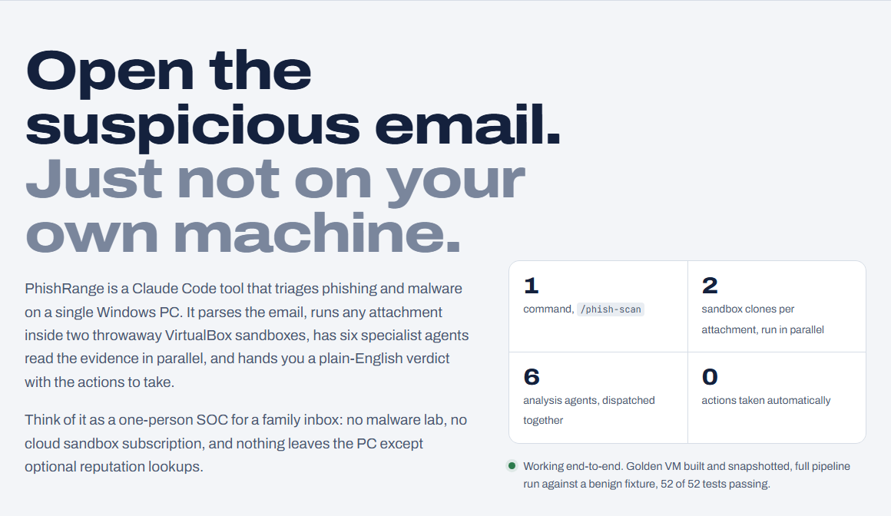
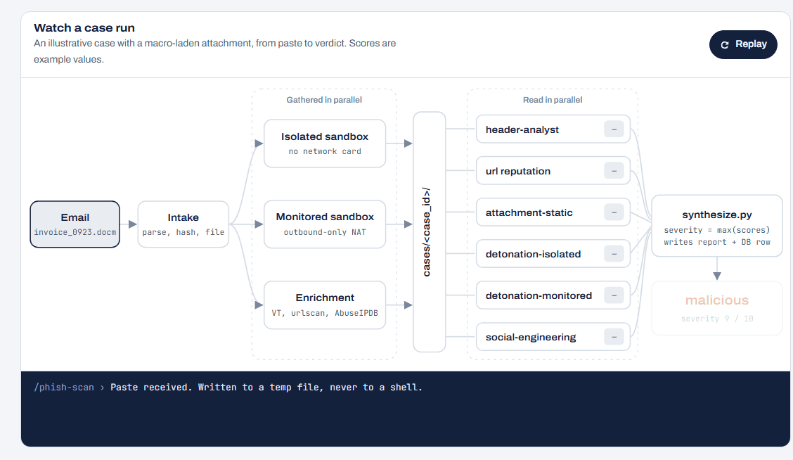
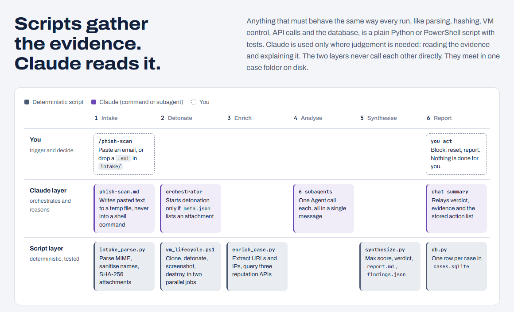
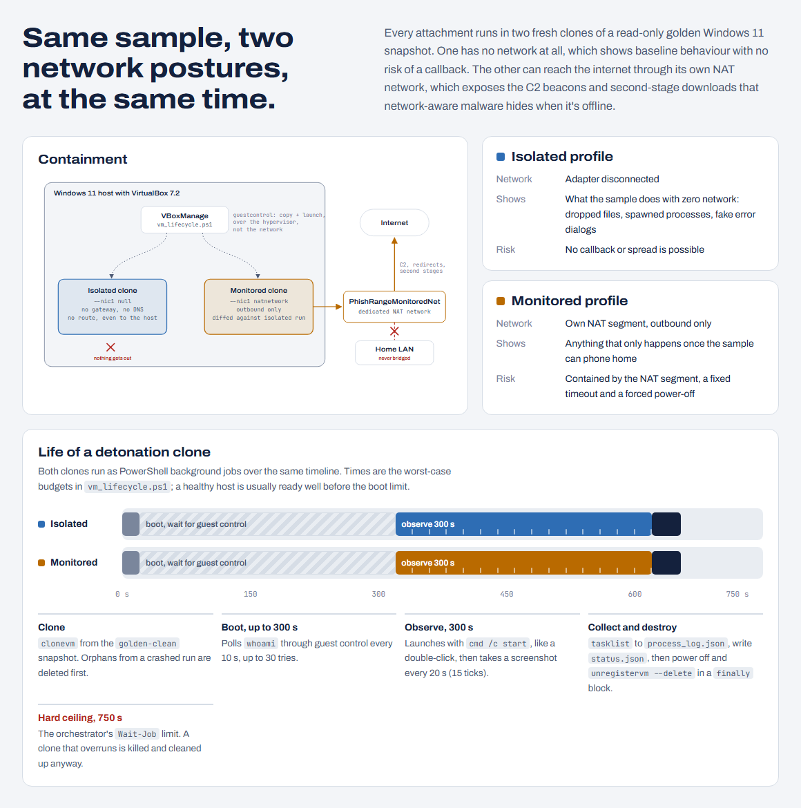
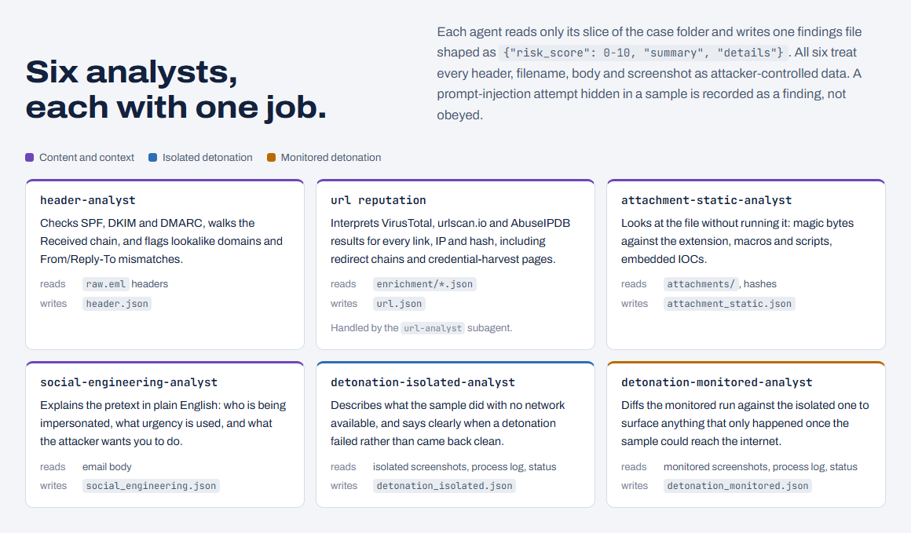
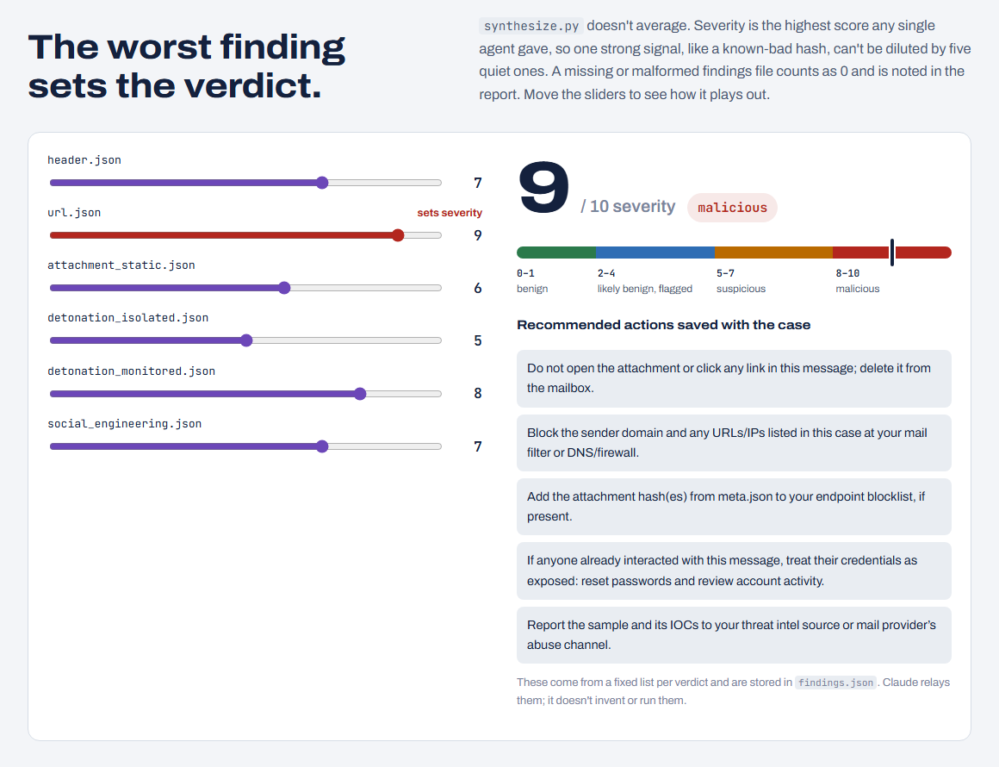
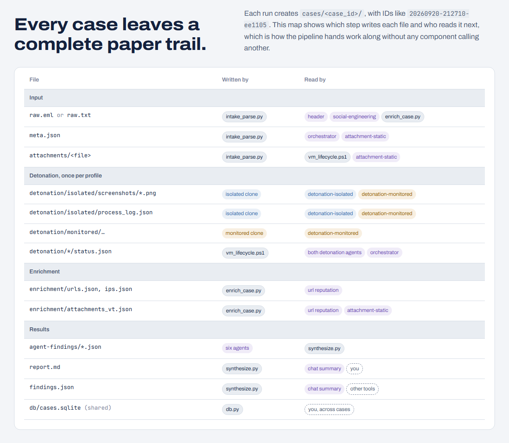
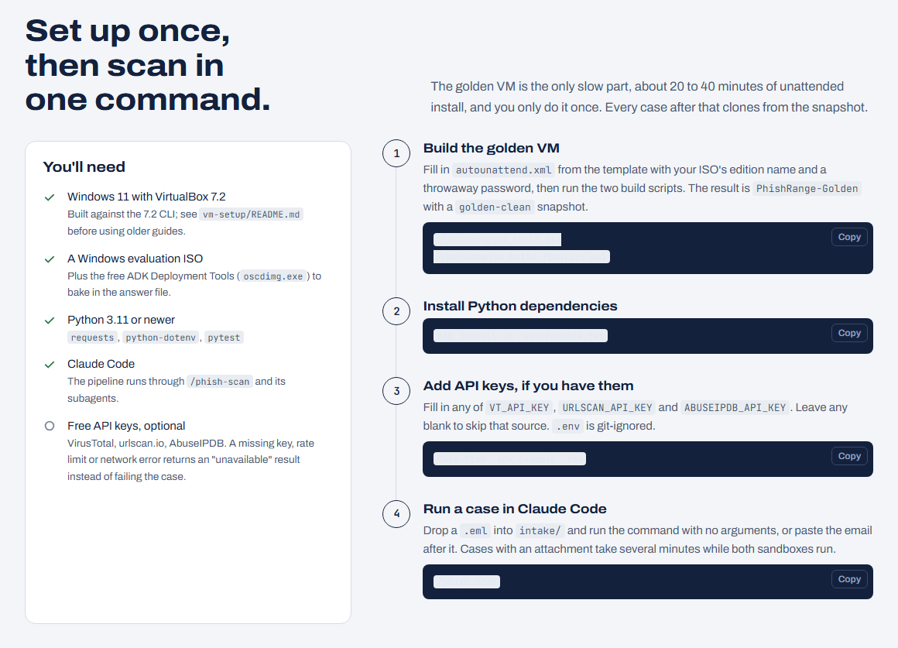
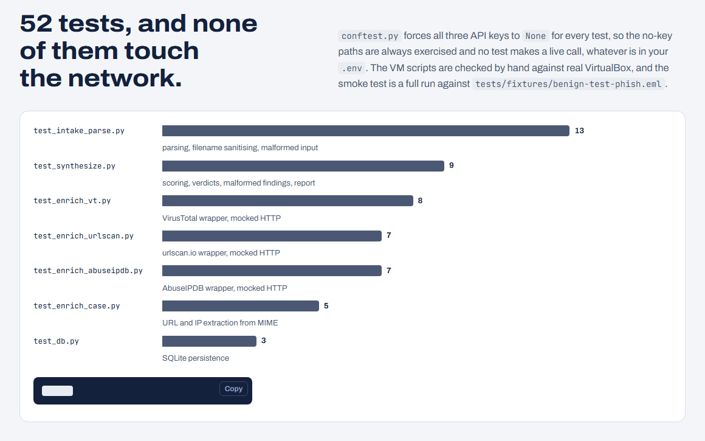
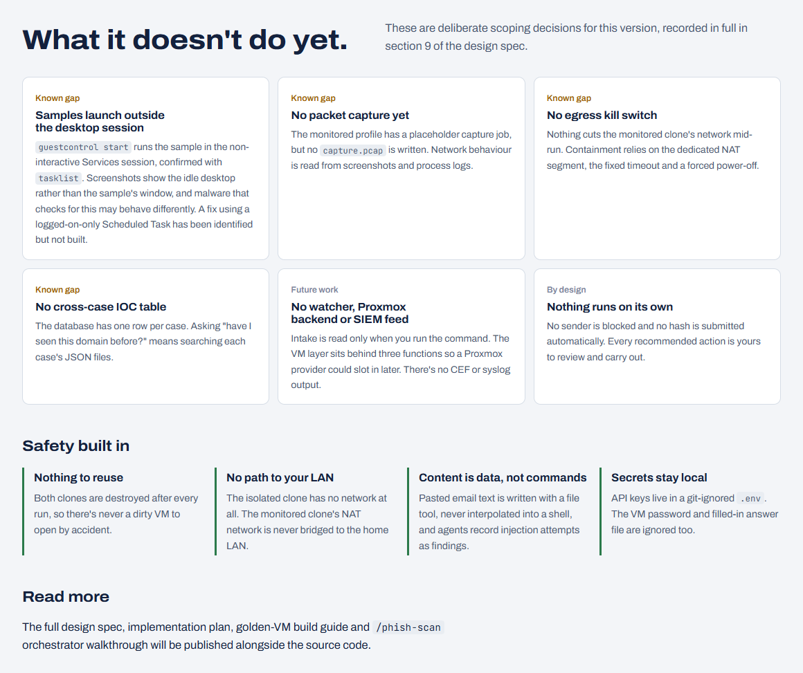

# PhishRange Showcase

**PhishRange** is a Claude Code tool that triages suspicious emails and attachments on a single Windows PC. It parses the email, detonates any attachment in two throwaway VirtualBox sandboxes (one isolated, one with monitored egress), runs six analysis agents in parallel, and writes a plain-English verdict with recommended actions. Nothing is actioned automatically.

This repo holds the visual showcase only.

> **Interactive version:** download [`index.html`](index.html) and open it in any browser. It includes the animated walkthrough, the severity calculator and copy-to-clipboard setup steps. The screenshots below show every section.

## A case, start to finish

One `/phish-scan` command takes an email from paste to verdict. Intake fans out to two sandboxes and reputation lookups, which all write into one case folder. Six agents read that folder in parallel, and `synthesize.py` turns their scores into a verdict.

## Scripts gather the evidence. Claude reads it.

Anything that must behave the same every run is a tested Python or PowerShell script. Claude is used only where judgement is needed. The two layers meet in the case folder on disk.

## Two sandboxes, two network postures

Every attachment runs in two fresh clones of a read-only golden Windows 11 snapshot: one with no network at all, one with outbound-only access through its own NAT network, never bridged to the home LAN.

## Six analysis agents

## The worst finding sets the verdict

Severity is the highest score any single agent gives, not an average, so one strong signal can't be diluted. In the interactive page you can move the sliders and watch the verdict and recommended actions change.

## Every case leaves a paper trail

## Setup

## Tests

## Limitations and safety

